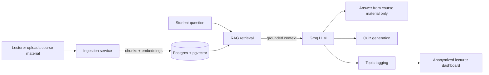

 

---

## 👋 About

I build **backend systems and AI-powered products**: secure APIs in Java/Spring Boot and Python, plus RAG apps and ML models that work on real data, for real users. I ship end to end, from the database to the deployed demo. When I'm not doing that, I'm building games.

|  |  |
|---|---|
| 🧠 **Focus** | Backend engineering (Java/Spring Boot, Python), RAG and applied ML |
| 🚢 **Recently shipped** | A RAG study assistant, a fraud-detection model, a recycling-rewards platform |
| 🎮 **On the side** | Games in C++ and Python |
| 🤝 **Open to** | Backend and AI-product work, collaborations |

### 🔨 Now building

- 📄 **[Dockly](https://github.com/adermgram/dockly)**: turn your documents into AI chatbots ([live](https://dockly-bay.vercel.app))
- 🏦 **[bank-api](https://github.com/adermgram/bank-api)**: FastAPI banking backend (JWT auth, Alembic, repository-service architecture), with transfers and tests next

### 🕒 Latest activity

<!--START_SECTION:activity-->
<!--END_SECTION:activity-->

---

## 🛠️ Tech Stack

| | |
|---|---|
| **Backend** |  |
| **Data** |  |
| **AI / ML** |     |
| **Frontend** |  |
| **Games** |    |

---

## 📊 GitHub Stats

---

## 🐍 Contribution Snake

<picture>
  <source media="(prefers-color-scheme: dark)" srcset="https://raw.githubusercontent.com/adermgram/adermgram/output/github-snake-dark.svg" />
  <source media="(prefers-color-scheme: light)" srcset="https://raw.githubusercontent.com/adermgram/adermgram/output/github-snake.svg" />
  
</picture>

---

## 🚀 Featured Projects

| Project | What it is | Stack |
|---|---|---|
| 🔐 [**docvault**](https://github.com/adermgram/docvault) | Secure document management API: JWT auth, role-based access, validated uploads (Tika), pagination and search, 18 unit tests | Java, Spring Boot, Spring Security, JPA, PostgreSQL |
| 🤖 [**smart-study-bot**](https://github.com/adermgram/smart-study-bot) · [demo](https://smart-study-bot-five.vercel.app) | RAG study assistant that answers only from lecturer-uploaded material, with anonymized weak-topic insights for lecturers | FastAPI, Postgres + pgvector, Next.js |
| ♻️ [**scan-cycle**](https://github.com/adermgram/scan-cycle) | Recycling rewards platform: QR scans, points, leaderboard, coupons, SMS alerts, admin dashboard | React, Node/Express, MongoDB |
| 🛡️ [**fraud-detection**](https://github.com/adermgram/fraud-detection) | Transaction fraud scoring tuned for Nigerian banking channels, with a staff review workflow | Flask, scikit-learn |
| 🎮 [**Tetris-game**](https://github.com/adermgram/Tetris-game) | Tetris clone, ⭐ 27 stars | C++, raylib, CMake |
| 🕹️ [**twin-stick-drift**](https://github.com/adermgram/twin-stick-drift) | Neon arena shooter with controller rumble and fully procedural audio | Python, pygame |

### 🧩 How smart-study-bot works

*FastAPI backend on Render, Next.js frontend on Vercel, OpenAI embeddings, Groq for chat, quizzes and tagging.*

---

## 🤝 Let's connect

**Open to:** backend and AI-product work, collaborations, and building something worth shipping.

*Got an idea or a problem worth solving? Reach out.*

